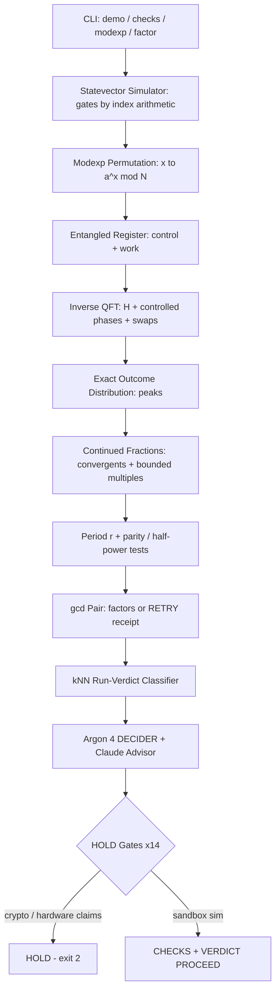
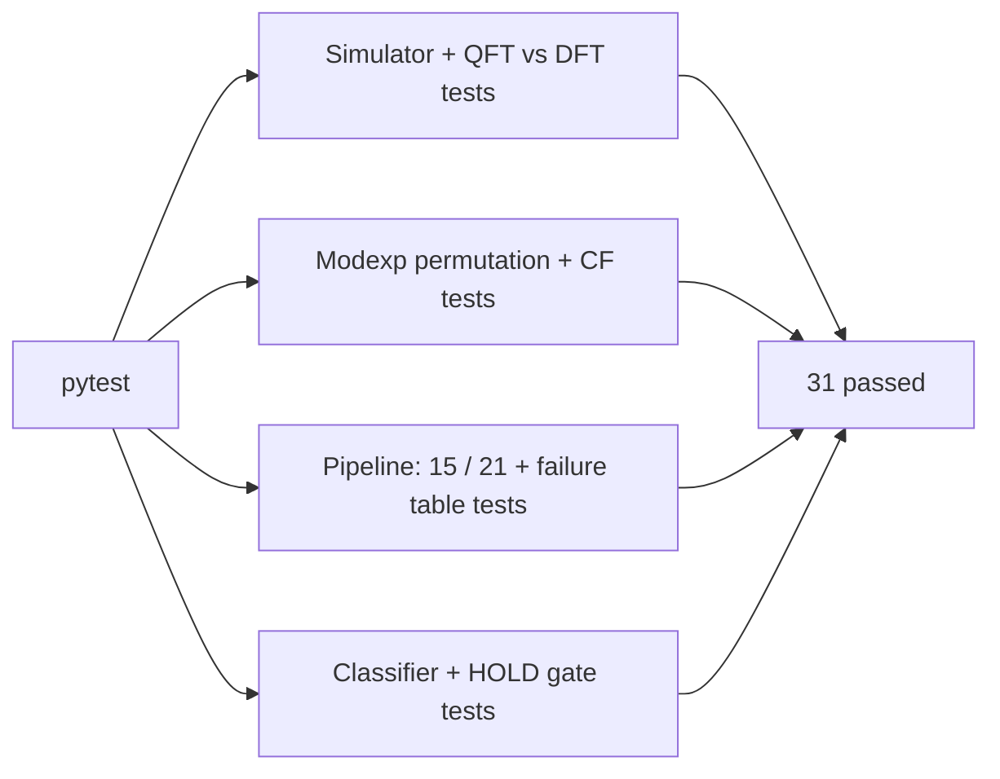
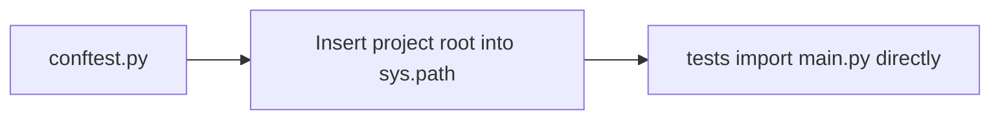
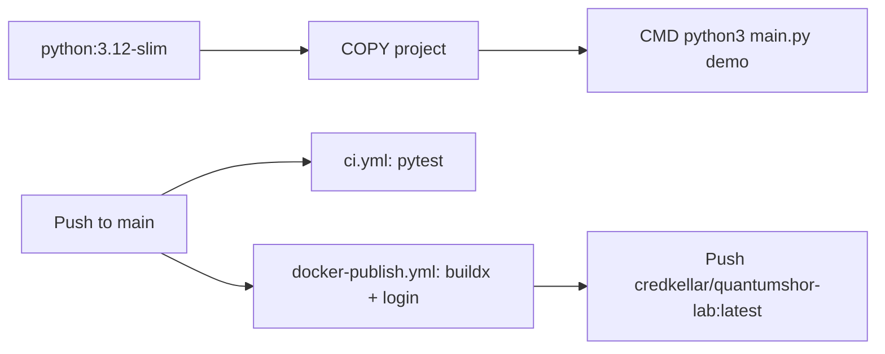

# QuantumShor-Lab 🔢⚛️

**Shor's Factoring & Quantum Period-Finding Lab** — by Darion Kellar

QuantumShor-Lab is an **educational Shor's algorithm lab** in ONE pure-Python file. Shor's algorithm is really two algorithms bolted together — a **quantum period-finding subroutine** and a **classical post-processing chain** — and this lab builds both halves from scratch and runs them end to end:

- **Modular exponentiation as an exact permutation unitary** — `|x>|y> -> |x>|y · a^x mod N>` by index arithmetic, so the whole sequence `a^x mod N` is written into the amplitudes of an entangled register 🔢
- **A Quantum Fourier Transform from scratch** — Hadamards, controlled phase rotations, and swaps, graded against the direct DFT definition on every basis state before it is trusted 🌊
- **Continued fractions from scratch** — the measured outcome `y/Q` is climbed down a convergent ladder to the period `r`, with a *bounded* multiples repair whose bound is stated as an honesty line 🪜
- **The failure table, printed** — odd period, `a^(r/2) = -1 (mod N)`, and a non-coprime base are first-class outcomes with a retry loop that keeps its receipts 🧾
- **A from-scratch kNN run-verdict classifier** whose labels come from the lab's own policy over its own runs 🏷️

Honest scope, stated up front: everything quantum here runs on a **classical statevector simulator that pays 2^n amplitudes** — factoring 15 costs 4,096 amplitudes and 21 costs 16,384, and those numbers are printed wherever a size appears. The lab demonstrates the **algorithm's structure**; it threatens no real cryptosystem, because a real one would need a quantum machine that does not exist here. Every RSA-breaking / key-recovery / cryptanalysis claim sits behind a permanent HOLD gate (14 total). 🔒

[](https://github.com/kimanicollier44-cmyk/QuantumShor-Lab/actions/workflows/ci.yml)
[](https://github.com/kimanicollier44-cmyk/QuantumShor-Lab/actions/workflows/docker-publish.yml)

> ℹ️ These are the **live** workflow badges for this repo. They activate as soon as the `ci.yml` and `docker-publish.yml` files from the paste pack are pasted into `.github/workflows/` — until then they have nothing to report yet.

## 🧰 Tech Stack Badges & Full Architecture Tech Stack

### 💻 Core Programming Languages & Core Systems


- 🐍 Python 3.12, pure standard library (`math`, `hashlib`, `json`, `sys`) — zero dependencies, zero network, deterministic (double-run byte-identical)
- 🔢 Quantum core: a from-scratch statevector simulator (H / X / Z / CNOT / controlled-phase / SWAP by index arithmetic on 2^n complex amplitudes), modular exponentiation as an **exact permutation unitary**, and a QFT built from Hadamards + controlled `R_m` rotations + swaps — graded against the direct DFT definition in CHECKS
- 🪜 Classical chain from scratch: continued-fraction convergents with a bounded multiples repair, Euler's theorem checks via `pow`, and the two closing gcd calls — no library does the algorithm's work
- 🧠 TinyML kNN run-verdict classifier (from scratch, stdlib): factorable-by-shor-toy / period-odd-retry / not-coprime / too-big-for-toy from (N size, r parity, a^(r/2) mod N)
- 🪑 Council seats: Gemini Argon 4 DECIDER (names-only, tighten-only) + Muse advisor (never overrides HOLD) + Google Flow plan-only (rendered = False, live = 0)

### ⛓️ Web3 & Infrastructure

- 🚫 **Not applicable — honestly.** No blockchain, no Web3, no tokens: the "infrastructure" in this lab is one offline file holding a simulated register, a permutation, and a fractions ladder. Cryptanalysis of anything real is a permanent HOLD gate, not a feature. No fake badges here.

### ⚙️ Platform Support & Hardware Architecture


- 🖥️ Pure Python — runs anywhere Python 3.12+ runs (Linux, macOS, Windows), plus the `python:3.12-slim` Docker image
- 🔒 No quantum hardware is touched, ever: real QPUs, cloud quantum services, and cryogenic plant are permanent HOLD gates (see the gate table below)

### ⚡ Low-Level Infrastructure & Performance

- 🚫 **No low-level code — honestly.** No C, no C++, no GPU, no compiled extensions: this is one interpreted Python file on purpose, so every amplitude can be read, checked, and diffed. Performance here means honest counting — the simulator's own exponential cost (2^(t+w) amplitudes) is printed wherever a size appears, and it is never merged with the gate-count story into a "speedup" headline.

### 🛠️ DevOps & Build Tools


- 🐳 Docker (`python:3.12-slim`), GitHub Actions CI + Docker Publish (delivered in the paste pack)
- 🎯 Target image: `credkellar/quantumshor-lab:latest`
- 🧪 Tests: `pytest` (31 tests) + the built-in CHECKS suite (52 checks) in `main.py`

### ☁️ Cloud Providers

- 🚫 **None — honestly.** No cloud provider is used or needed: the lab runs fully offline on your own machine or in a local Docker container. Docker Hub appears only as the registry the publish workflow pushes the image to.

## What this does?

1. 🔢 **The period is in the sequence** — before any qubit moves, the classical sequence shows the structure: `7^x mod 15 = 1, 7, 4, 13, 1, ...` (period **4**) and `2^x mod 21 = 1, 2, 4, 8, 16, 11, 1, ...` (period **6**). The modexp unitary is an exact permutation of basis states (bijectivity asserted in CHECKS); applied after Hadamards it entangles the control register with the work register so cleanly that the work values `{1, 4, 7, 13}` each carry probability exactly **0.25**.
2. 🌊 **QFT, graded against its own definition** — the circuit (Hadamards + controlled `R_m` phase rotations + swaps) is checked amplitude-by-amplitude against the direct sum `(1/√Q) Σ e^{2πixy/Q}` on **every basis state** of a 3-qubit register, and a period-4 state on Q = 256 comes out of the inverse QFT with probability exactly **0.25 at y = 0, 64, 128, 192** and < 1e-12 everywhere else. The transform is verified, not vibes.
3. 🎯 **Headline run: 15 = 3 × 5** — a = 7, t = 8 control qubits (Q = 256 ≥ 15²), w = 4 work qubits: **12 qubits, 4,096 amplitudes**. The exact outcome distribution is four peaks of **0.25**; the first usable peak y = 64 climbs the convergent ladder to **1/4**, so r = 4, `a^(r/2) mod N = 4`, and `gcd(4−1, 15) × gcd(4+1, 15)` returns **3 × 5**. Every step is printed.
4. 🎯 **Second run: 21 = 3 × 7** — a = 2, t = 9 (Q = 512), w = 5: **14 qubits, 16,384 amplitudes**. Here r = 6 does **not** divide Q, so the peaks spread honestly: **0.166672** at y = 0 and y = 256, **0.113989** at y = 85, 171, 341, 427, and a visible leakage tail (0.0285 at y = 86, 170). The y = 256 peak gives the convergent **1/2** — a divisor of the true period — and the bounded repair (×3) recovers **r = 6**; `2^3 mod 21 = 8`, and the gcd pair returns **3 × 7**.
5. 🪜 **Continued fractions with an honesty bound** — convergents are tested first, then only the multiples **2q and 3q**. The bound is the point: with unbounded multiples, the q = 1 convergent would "recover" any period by scanning m = 1, 2, 3, ... — which is classical order-finding wearing a quantum hat, and this lab does not wear it. (The same ladder turns 85/512 into the convergent **1/6**.)
6. 🧾 **The failure table — printed, not hidden** — a = 14 on N = 15 finds r = 2 but `14 = −1 (mod 15)`, so the gcd pair is trivial: **retry**. a = 4 on N = 21 recovers an **odd r = 3** from y = 171 (P = 0.227974, convergent 1/3): **retry**. a = 5 on N = 21 finds r = 6 with `5^3 = 20 = −1 (mod 21)`: **retry**. a = 6 on N = 21 is **not coprime** — gcd(6, 21) = 3 is already a factor, found classically before any qubit moves. The retry loop on N = 15 keeps both receipts: 14 fails, then 7 factors.
7. ⚖️ **Classical baseline — counted, and honestly faster here** — trial division factors both demo numbers in **2 counted steps** (N = 49 takes 6, N = 221 takes 12). At toy sizes the classical baseline wins and the lab says so. The scaling statement is kept in three separate columns that are never merged: trial division ~ √N tests, Shor's gate count polynomial in log₂N **on a quantum machine**, and this simulator's 2^(t+w) amplitudes.
8. 🏷️ **Verdict classifier + seats + checks** — a from-scratch kNN labels runs factorable-by-shor-toy / period-odd-retry / not-coprime / too-big-for-toy (a = 7 on 15 and a = 2 on 21: factorable; a = 14, 4, 5: retry; a = 6 on 21: not-coprime; a = 2 on 33: too-big-for-toy), with Argon 4 DECIDER (sha256 trace), Muse advisor, Google Flow plan-only, and a built-in CHECKS suite (52 checks).

## 🗺️ How it works — diagram per script

### `main.py` — the whole lab



### `tests/test_main.py` — verification



### `conftest.py` — test path setup



### `Dockerfile` + CI flow — container & publish



## Why is this cool?

1. 🎯 It **actually factors, end to end**: Hadamards, a permutation unitary, an inverse QFT, a fractions ladder, and two gcd calls turn 15 into 3 × 5 and 21 into 3 × 7 — no step is stubbed, mocked, or quoted.
2. 🌊 The QFT is **graded against its own definition** on every basis state before it is trusted — most demos ask you to believe the transform; this one proves it in CHECKS.
3. 🔢 The modexp unitary is a **permutation, not a matrix**: amplitudes are moved, never approximated, so the entangled work register's distribution ({1, 4, 7, 13} at exactly 0.25 each) is exact arithmetic you can audit.
4. 📊 Probabilities are **read off the statevector**, not sampled: the 21 run's leakage tail (0.0285 at y = 86) is the real distribution a perfect machine would sample from, printed to six decimals.
5. 🪜 The continued-fraction repair has an **honesty bound**: multiples stop at 3q, because an unbounded scan is classical order-finding in a costume — the lab names the cheat instead of committing it.
6. 🧾 Failures are **first-class outputs**: odd period, a^(r/2) = −1, non-coprime base — each with its measured peaks and its retry receipt, because real Shor runs fail exactly this way most of the time.
7. ⚖️ The classical baseline is **counted and allowed to win**: trial division factors 15 in 2 steps, and the lab prints that next to its 4,096 amplitudes without flinching.
8. 🏷️ The classifier's labels come from the lab's **own policy over its own runs** — and CHECKS verifies the kNN reproduces the policy on every grid row, so the verdict layer cannot quietly drift from the rule it claims to implement.
9. 🔒 The honesty is structural: 14 named HOLD gates (`rsa_breaking_claim`, `real_key_recovery`, `quantum_hardware_claim`, `real_world_speedup_claim`...) return exit code 2, forever.
10. 🎯 Deterministic end to end: run it twice, get byte-identical output — a factoring lab you can diff.

## What problems this solves?

1. ❌ **Problem:** Shor explainers jump from "quantum magic" to "RSA is dead" with nothing in between. ✅ **Solution:** Every intermediate object is computed and printed — the sequence, the entangled distribution, the peaks, the convergent, the gcd pair — so the algorithm is a chain of checkable steps, not a slogan.
2. ❌ **Problem:** "The QFT finds the period" is asserted, never verified. ✅ **Solution:** The circuit is graded against the direct DFT definition on all basis states at t = 3, and the periodic-state peak structure (0.25 exactly at multiples of Q/r) is asserted to 1e-9.
3. ❌ **Problem:** Toy factoring demos quietly use the known answer. ✅ **Solution:** The period is recovered from the measured distribution by continued fractions, and CHECKS holds the quantum recovery to the classical order yardstick (r = 4 and r = 6, independently computed).
4. ❌ **Problem:** The classical post-processing is treated as a footnote. ✅ **Solution:** It is half the lab: convergents, the bounded-multiples repair, the parity test, the −1 test, and the gcd pair each get code, checks, and demo lines.
5. ❌ **Problem:** Failed runs disappear from write-ups, though they dominate real runs. ✅ **Solution:** The failure table is a demo section with measured peaks for all three failure modes, plus a retry loop that keeps its receipts.
6. ❌ **Problem:** "Quantum speedup" gets claimed from a classical simulation. ✅ **Solution:** Three cost models are printed in three columns — trial-division steps counted, gate-count scaling labelled as a statement about a machine that does not exist here, and the simulator's own 2^(t+w) amplitude bill — and never merged.
7. ❌ **Problem:** Simulator sizes are hidden, making toy results look free. ✅ **Solution:** Every run prints t, Q, w, qubits, and amplitudes (4,096 for 15; 16,384 for 21), and the toy cap N ≤ 21 is explained as a simulator limit, not an algorithm limit.
8. ❌ **Problem:** Continued-fraction recovery is presented as automatic. ✅ **Solution:** The y = 256 case is shown honestly — its convergent is 1/2, a divisor of r = 6 — and the repair is bounded and documented rather than an invisible scan.
9. ❌ **Problem:** Non-coprime bases are treated as errors instead of information. ✅ **Solution:** The gcd check runs first and its result is reported as what it is — a factor found classically (gcd(6, 21) = 3) — with the quantum run correctly never started.
10. ❌ **Problem:** Simulation tools quietly imply a cryptosystem is next. ✅ **Solution:** `rsa_breaking_claim`, `real_key_recovery`, `intercept_decrypt_claim`, and `production_cryptanalysis_use` are permanent HOLD gates — the toy factors 15 and 21, and the lab says exactly that and nothing more.

## How to install this?

1. 📋 Clone or download this project folder.
2. 🐍 Make sure Python 3.12+ is installed: `python3 --version`
3. ▶️ Run the full demo + checks (no arguments needed):

```bash
python3 main.py
```

4. 🧪 Run the test suite:

```bash
pip install pytest
python3 -m pytest -q
```

5. 🎛️ Try the other commands:

```bash
python3 main.py checks    # 52 built-in checks
python3 main.py modexp    # a^x mod N sequence + classical order (JSON)
python3 main.py qft       # periodic-state inverse-QFT peaks (JSON)
python3 main.py period    # quantum half only: register sizes + peaks (JSON)
python3 main.py factor    # full pipeline for one (a, N) pair (JSON)
python3 main.py classical # counted trial-division baseline (JSON)
python3 main.py classify  # kNN run-verdict classifier report
python3 main.py brains    # Argon 4 + Muse + Flow seats
python3 main.py holds     # list all 14 HOLD gates
python3 main.py hold-demo # exits 2 - gated actions stay HOLD
```

6. 🐳 Or run it in Docker:

```bash
docker build -t credkellar/quantumshor-lab:latest .
docker run --rm credkellar/quantumshor-lab:latest
```

## Requirements

- 🐍 Python 3.12 or newer
- 📦 Dependencies: **none** (standard library only)
- 🌐 Network: **none** — fully offline
- 🧪 For tests only: `pytest`
- 🐳 Optional: Docker

## FULL project structure tree

```text
quantumshor-lab/
├── main.py                  # the whole lab: statevector simulator, QFT, modexp permutation, continued fractions, Shor pipeline + failure table, trial-division baseline, classifier, seats, HOLD gates
├── conftest.py              # puts the project root on sys.path for tests
├── tests/
│   └── test_main.py         # 31 pytest tests: simulator, QFT vs DFT, modexp, continued fractions, pipeline success + failure table, classifier, gates, determinism
├── assets/
│   └── cover.png            # README cover image (2736 x 912)
├── Dockerfile               # python:3.12-slim, runs the demo
├── .gitignore               # __pycache__/, .pytest_cache/, *.pyc
└── README.md                # this file
```

> 📦 Delivered separately as paste packs (not in this tree): `.github/workflows/ci.yml` + `docker-publish.yml`, and the Docker Hub pack (100-char description, 350-char About, overview, categories).

## 🔒 HOLD gates — all 14, permanent

| # | Gate | What stays held |
|---|------|-----------------|
| 1 | `rsa_breaking_claim` | No claim of breaking RSA; factoring 15 and 21 on a classical simulator demonstrates an algorithm's structure, not an attack |
| 2 | `real_key_recovery` | No recovering real private keys, seed phrases, or credentials of any kind |
| 3 | `ecc_discrete_log_attack_claim` | No claim of attacking deployed elliptic-curve or discrete-log systems; the period-finding idea is taught, not weaponised |
| 4 | `intercept_decrypt_claim` | No decrypting intercepted, captured, or anyone else's traffic or files |
| 5 | `production_cryptanalysis_use` | No production cryptanalysis use; a teaching simulator with a toy cap of N = 21 |
| 6 | `quantum_hardware_claim` | No claim of access to, or results from, real quantum hardware; every run here is a classical simulation |
| 7 | `real_world_speedup_claim` | No practical speedup claim; the simulator pays 2^n amplitudes, and the speedup statement concerns gate counts on a machine that does not exist here |
| 8 | `password_or_hash_cracking` | No live password, PIN, or hash cracking; nothing here searches a credential space |
| 9 | `financial_system_attack_claim` | No attacking banks, payment networks, exchanges, or financial infrastructure |
| 10 | `surveillance_claim` | No surveillance, tracking, or intelligence-collection use or claim |
| 11 | `benchmark_vendor_claim` | No vendor or hardware benchmark claim; counts are against this file's own classical baselines |
| 12 | `patent_or_priority_claim` | No patent, priority, or first-discovery claim; this is Shor's 1994 algorithm, taught from the textbook |
| 13 | `investment_claim` | No investment claims; a factoring demo is not a prospectus |
| 14 | `certification_claim` | No certification, accreditation, or compliance claim of any kind |

🧑‍⚖️ **Council seats:** Gemini Argon 4 Extended Thinking — DECIDER (names-only, tighten-only, MAP → MODEL → STRESS → DECIDE, sha256 trace, `can_override_hold = False`) · Muse — advisor (`can_override_hold = False`) · Google Flow — plan-only (`rendered = False`, `live = 0`).

✅ **Verification:** pytest **31 passed** (project + clean copy) · built-in CHECKS **52/52** · double-run output **byte-identical** · `hold-demo` exits **2** · `main.py` **1,003 lines**, pure stdlib, zero network.

## 🧒 5th-grade English section

Imagine someone picks a secret multiplication, like **3 × 5 = 15**, and only tells you the answer: 15. Your job is to figure out the two secret numbers. That puzzle is called **factoring**, and it is easy for tiny numbers and painfully slow for giant ones — so slow that the secret codes protecting bank accounts are built on it. 🔐

- A scientist named Peter Shor found a shortcut, but it needs a **quantum computer** — a special machine that can hold a number in many positions at once, like a spinning coin that is heads and tails together. 🪙
- The shortcut does not guess the secret numbers directly. Instead it finds a **repeating pattern**: if you keep multiplying by the same number and only keep the leftovers (that is the "mod" part), the leftovers repeat — 1, 7, 4, 13, 1, 7, 4, 13... The length of the repeat is called the **period**, and once you know it, ordinary math (a fractions ladder and a greatest-common-divisor trick) hands you the secret numbers. 🔁
- The quantum machine finds the period with a wave trick called the **Quantum Fourier Transform** — think of it as a comb that makes the repeating pattern stand up in tall spikes, so you can read the spacing. 🌊
- This project does not have a quantum computer. It **pretends** — a normal computer imitating a quantum one, number by number. Pretending is expensive: factoring the tiny number 21 already needs 16,384 numbers held at once. That is why this lab only factors baby numbers like 15 and 21. It is a **learning toy**, and no real secret code is in any danger from it. 💻
- Sometimes the trick fails: the pattern length comes out odd, or the math lands on the one bad answer. The lab does not hide those runs — it prints them in a **failure table** and tries again with a different starting number, just like the real algorithm does. 🧾

---

MIT © 2026 Darion Kellar · QuantumShor-Lab — educational simulation only 🔢
